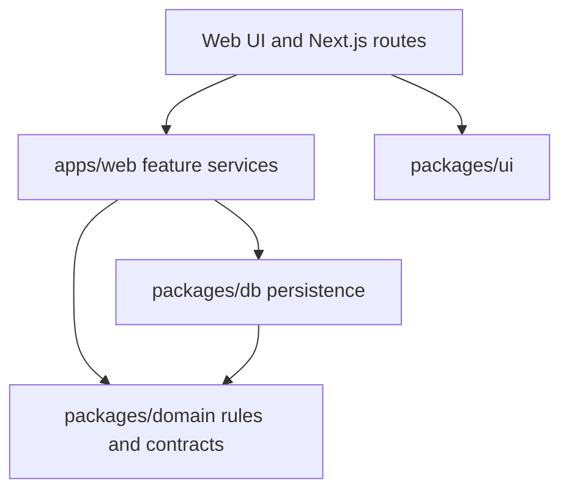

# Clean Feature Boundaries

**Status:** Approved for implementation (2026-10-18)

## Intent

Make it obvious where a developer should look for a booking, workspace, or receptionist change. Keep responsibilities separate across the existing Turborepo app and library packages, while preserving current product behavior and database migrations.

The recent move into `apps/web`, `packages/domain`, `packages/db`, and `packages/ui` established the package layout but left important responsibilities mixed. The web app still issues Drizzle queries for chat sessions, MCP proposals, HTTP rate limits, and readiness. Database modules accept unparsed input, make product decisions, map dashboard data, and coordinate workflows. Client components infer their props from a database function. The database schema also imports a message type from the Strands SDK. Generic server actions route several unrelated operations through string switches, while domain errors carry HTTP status codes. `WorkspaceApp` is also a 1,400-line client component that owns navigation, every dashboard section, editor state, account updates, and several workspace actions.

## Goals

- Make `apps/web` the composition layer for Next.js routes, server actions, authentication, email, AI providers, and feature use cases.
- Keep `packages/domain` independent of persistence and providers. It owns business contracts, input validation, and pure business rules.
- Define persisted status, membership role, and booking location values as regular TypeScript string enums, not PostgreSQL native enum types.
- Keep `packages/db` focused on Drizzle schema, connections, queries, and atomic persistence operations. It must not depend on AI SDK types or HTTP response behavior.
- Give client components explicit feature-level view types rather than types inferred from database functions.
- Split server actions and feature modules by business area and responsibility.
- Use the existing Turbo package graph and package entry points; do not add packages without a distinct shared responsibility.
- Preserve runtime behavior and existing migrations. Keep the user's preference not to add tests; use lint, type checks, builds, and a Drizzle schema-generation check for verification.

## Proposed ownership

`apps/web/src/features/{bookings,workspaces,receptionist}` will hold cohesive server-side use cases and their client-facing view types. Routes and server actions will authenticate, parse transport details, call one feature operation, and translate expected failures for the transport. Provider setup, email delivery, cookies, and Next.js cache revalidation remain app integrations.

`packages/domain` will contain pure booking, workspace, and receptionist policies, schemas, and shared business types. It will not import `@welio/db`, Drizzle, Next.js, Node server APIs, HTTP status concepts, or provider SDKs. Domain errors will describe application or business failures; web transport adapters will map them to HTTP status codes. Provider-specific conversation message types will stay in the receptionist integration; the database will store an app-owned JSON-compatible shape.

`packages/db` will keep schema files grouped by business area and expose focused persistence entry points. It will own SQL queries, row-to-record mapping, transaction boundaries needed for atomic writes, database conflict handling, readiness checks, and rate-limit storage. It may depend on domain-owned types and stable persisted-value constants, but it will not own input parsing, product-level orchestration, route/action dispatch, email delivery, AI orchestration, HTTP status mapping, or user-facing messages. Existing transactional constraints and locking behavior must remain intact. The Better Auth Drizzle adapter stays in the web authentication composition module as an explicit integration edge.

The domain will define string enums for membership roles, booking locations, and appointment statuses. PostgreSQL will store these values in `text` columns with Drizzle's TypeScript typing and database `CHECK` constraints. This avoids PostgreSQL enum types while keeping invalid values out of stored rows. A forward-only migration will convert the existing native enum columns to text and remove the native types; historical migrations remain unchanged.

The workspace dashboard response will be an explicit web feature view model. Its query will be composed from focused workspace, service, staff, booking, customer, time-off, membership, invitation, and notification data access, and will return only fields needed by the dashboard. Onboarding and dashboard flows will request the data they need through the workspace feature. `WorkspaceApp` will become a small dashboard shell that delegates each section and its state to focused section components; account profile changes will remain in the account feature.

## Scope and sequence

1. Establish dependency and responsibility boundaries; move raw SQL/Drizzle use out of web request handling (chat/MCP persistence, rate limits, readiness), leaving the auth adapter as an app integration edge.
2. Split mixed receptionist chat and MCP workflows into web orchestration and database persistence, removing the Strands dependency from `packages/db`.
3. Move booking/workspace use-case coordination and product policy out of database modules where it is currently coupled to persistence; keep atomic data changes behind focused database operations.
4. Replace generic string-dispatched dashboard actions with domain-specific actions, replace database-inferred component props with explicit feature view types, and split the all-sections `WorkspaceApp` into a shell and section components.
5. Update package exports, remove dependencies that no longer belong to each package, and document the directory map and rules for future code.
6. Add a forward migration for the enum-to-text conversion without editing historical migrations. Verify with `pnpm lint`, `pnpm check`, `pnpm build`, and a Drizzle generation check against a temporary project copy.

## Constraints and calls left to the builder

- Keep the four existing workspaces and current app behavior.
- Keep transaction boundaries around related database writes; do not trade consistency for smaller functions.
- Retain database constraints and atomic conflict checks for storage integrity; put input parsing and product policy in domain or feature code.
- Use TypeScript string enums as the code-level source of truth and matching text-column `CHECK` constraints for database integrity; do not use PostgreSQL native enum types.
- Preserve the existing auth adapter as an app integration point even though it uses the database schema.
- Do not add tests. Remove any remaining test-only files only when they are obsolete and not used by build or lint workflows.
- Avoid creating one-file abstractions or extra packages that do not clarify ownership.
- Split files when their responsibilities diverge; do not enforce an arbitrary line-count limit.

## References

- [Turborepo internal packages](https://turborepo.dev/docs/core-concepts/internal-packages)
- [Turborepo package types](https://turborepo.dev/docs/core-concepts/package-types)
- [Drizzle schema declaration and organization](https://orm.drizzle.team/docs/sql-schema-declaration)
- [Drizzle PostgreSQL column types](https://orm.drizzle.team/docs/column-types)
- [Drizzle indexes and constraints](https://orm.drizzle.team/docs/indexes-constraints)
- [Drizzle transactions](https://orm.drizzle.team/docs/transactions)

## Builder check

An independent builder review found no important unanswered questions on 2026-10-18.
